[Website](https://hugo.gutan.dev/) · [LinkedIn](https://www.linkedin.com/in/hugo-romero-rico/) · [Medium](https://medium.com/@romerorico.hugo) · [Email](mailto:romerorico.hugo@gmail.com)

After years doing AI at a large company, I made the jump to the startup world as a founding engineer. These days that means making AI workloads use GPU infrastructure more efficiently, squeezing more training and inference throughput out of the same hardware.

## Currently

- Founding engineer at [Feniria](https://feniria.com). The question we keep chasing: how much more can you get out of the GPUs you already own (or rent), without touching model code? More than you'd expect.
- Recently on stage at [VDS 2026](https://www.vds.tech) in Valencia with "Running self-hosted LLMs efficiently".
- Freelancing on the side, open to conversations with companies figuring out their approach to AI.

## Problem Solving

I fell in love with programming while studying mathematics engineering, when I discovered Python. That led me into a dual degree in Computer Science and Business Administration with a Machine Learning specialization, capped off by a university research project using [genetic algorithms](https://en.wikipedia.org/wiki/Genetic_algorithm) and [association rules](https://en.wikipedia.org/wiki/Association_rule_learning) to find patterns in real customer data, back when [NLP](https://en.wikipedia.org/wiki/Natural_language_processing) was only another field of AI.

Yes, I miss the sensation of getting lost for hours in programming, line by line, char by char.  
No, I don't do that anymore.

From there I started writing backend code in Java, moved into AI at that same company, and ended up leading the team responsible for architecture, infrastructure, and innovation for AI systems serving millions of customers.

Still, my approach (and passion) is always problem solving. It started with math olympiads in high school, then moved into competitive programming ([HashCode](https://en.wikipedia.org/wiki/Hash_Code_(programming_competition)) with friends & pizza was an unbeatable plan), and later became designing scalable AI architectures inside a large company. Today it shows up as strategy: how to build an AI native company, how to bring AI into an existing one, how to approach a client who doesn't know where to start. It's all the same coin, really. Richard Rumelt put it better than I could: [strategy is problem solving](https://www.youtube.com/watch?v=83vczUPiMv0).

I like the idea of standing on the shoulders of giants. Mine, so far:
- Strategy: Richard Rumelt
- Complex problem solving: Javier Recuenco
- AI & hands-on engineering: the list would be endless, here are a few: Andrej Karpathy, Chip Huyen, Paul Iusztin, Maxime Labonne, Paolo Perrone, Miguel Otero...

## Building

Open source, usually born from a real annoyance:

| Project | What it is |
|---|---|
| [decision-sandbox](https://github.com/hugoromerorico/decision-sandbox) | Test typed AI decisions without a model. A free synthetic API for decision models: change the `base_url` and you get correctly typed answers back, random, seeded or scripted to fail. Zero intelligence in it, but it does the job when you want to test the plumbing. |
| [decision-model-patterns](https://github.com/hugoromerorico/decision-model-patterns) | Patterns for decision models as nodes in LangGraph agents: routing and reranking so far, more planned. For when an LLM call exists only to produce a decision. |
| [production-agent-cookiecutter-langgraph](https://github.com/hugoromerorico/production-agent-cookiecutter-langgraph) | A project layout for agents that have to go to production: LangGraph, FastAPI, Pydantic, Docker and uv. |

[Cherrykite](https://cherrykite.com), my independent studio for small web products:

| Product | What it is |
|---|---|
| [Flagwise](https://cherrykite.com/flags) | Learn every flag: a daily 10-flag quiz, spaced-repetition practice and one page per flag. |
| [Papelito](https://cherrykite.com/secret-santa) | Secret Santa draw for a group, no sign-up. One shared link, everyone picks their name and sees only their match. Also as [amigo invisible](https://cherrykite.com/amigo-invisible). |

And a few contributions so far to:
- [Pydantic](https://github.com/pydantic/pydantic), the Python library that enforces data types.
- [A2A](https://github.com/a2aproject/A2A), the communication protocol for AI agents talking to each other.
- [A2UI](https://a2ui.org/), the communication protocol that lets AI agents decide the UI.

I'd like to do more. I believe in open source.

## Writing

- [Structuring AI Agent Projects for Production with LangGraph](./articles/structuring-agent-projects/structuring-agent-projects.md)
- [LangGraph 1.0 Released: No Breaking Changes, All the Hard-Won Lessons](./articles/langgraph-1.0/langgraph-1.md)

More on [Medium](https://medium.com/@romerorico.hugo).

## Tech Stack

This used to be the list of stacks I considered myself an expert in. Switching between technologies is easy enough now that expertise like that stops mattering much. These are simply my preferred tools, my winners.

| Area | My winners | |
|---|---|---|
| Agent orchestration | Python · LangGraph · LangChain · Langfuse | |
| LLM serving | vLLM | Where most of my days go now. |
| Machine learning | PyTorch · Weights & Biases · Kubeflow Pipelines · Hugging Face | |
| Cloud | GCP · Cloudflare · AWS · Azure | |
| Deploying infrastructure | Terraform · Ansible | I also like the idea behind [Pulumi](https://www.pulumi.com/). |
| Frontend | Astro · React · Next.js | In that order. |
| Infra | Kubernetes | I also like the idea of [unikernels](https://en.wikipedia.org/wiki/Unikernel). |

## Connect

I'm always up for connecting and meeting new people. If you're running your own models or thinking about it, let's talk: [LinkedIn](https://www.linkedin.com/in/hugo-romero-rico/), [email](mailto:romerorico.hugo@gmail.com) or [my site](https://hugo.gutan.dev/).

---

I lost access to my other GitHub account when I left a company. If you're curious about my sad, mostly-empty contribution graph over here ([hugoromerorico](https://github.com/hugoromerorico)), the other account is [hugo-romero-mm](https://github.com/hugo-romero-mm).

  

---

✍️ *"I'm not superstitious, just a little stitious"* – Michael Scott
